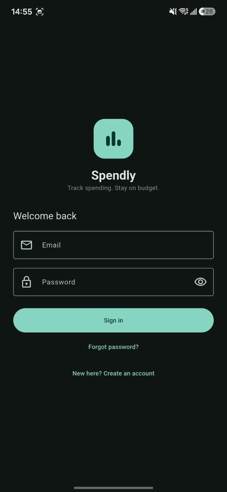
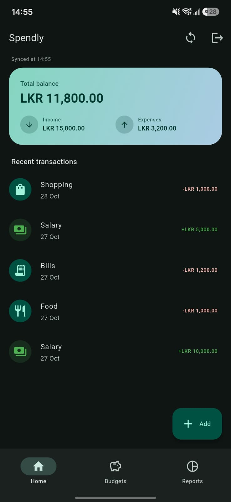
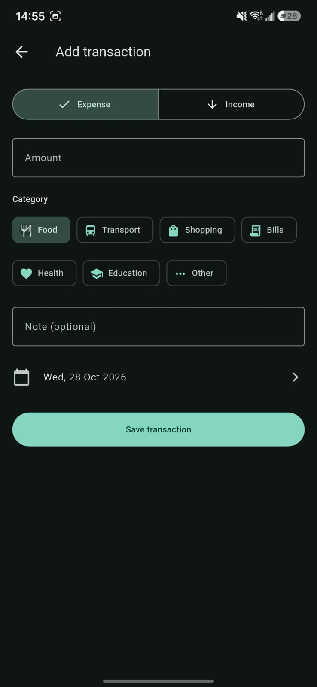
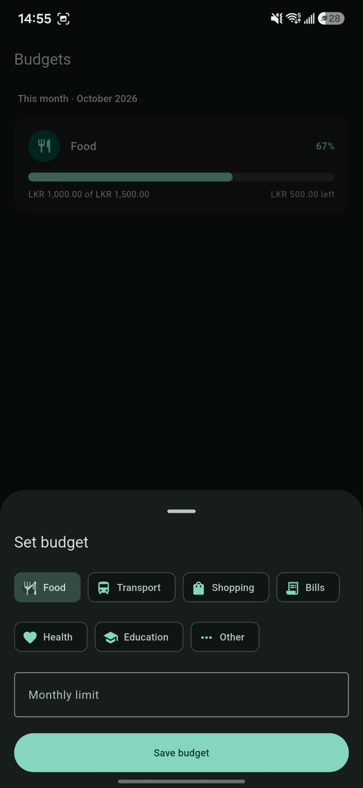
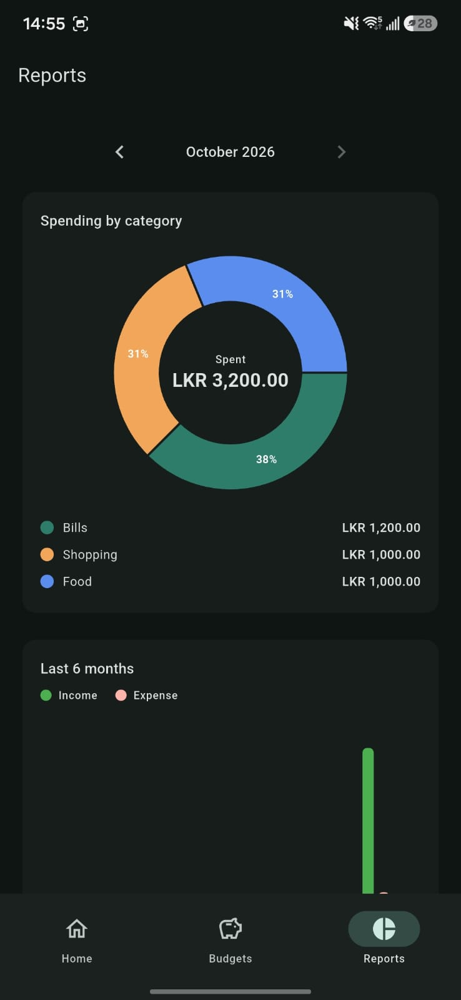
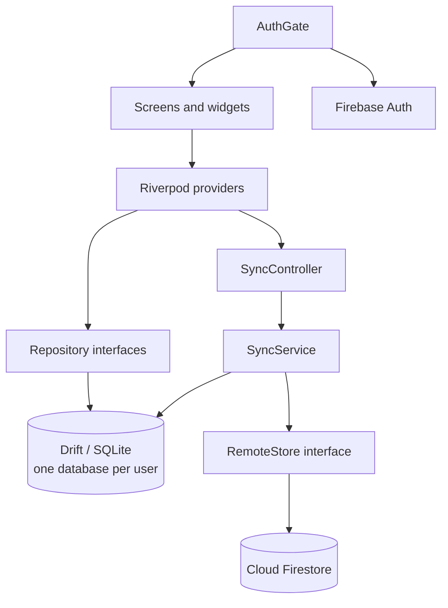

# Spendly


**An offline-first expense tracker for Android that keeps working without internet and syncs across devices when you're back online.**

Track income and expenses, set monthly budgets per category, and see where your money goes. Your data lives on the phone first (SQLite), then syncs to your private cloud space (Firestore), so it also survives reinstalling the app or switching phones.

**[⬇ Download the APK](https://github.com/YasOnline177/spendly/releases/latest)** (Android; you may need to allow installs from unknown sources)

## Screenshots

<table>
  <tr>
    <td align="center"><br><sub>Sign in</sub></td>
    <td align="center"><br><sub>Balance &amp; transactions</sub></td>
    <td align="center"><br><sub>Add transaction</sub></td>
  </tr>
  <tr>
    <td align="center"><br><sub>Monthly budgets</sub></td>
    <td align="center"><br><sub>Reports</sub></td>
    <td></td>
  </tr>
</table>

## Features

- **Accounts:** email and password sign-up with **email verification**, sign-in, password reset
- **Transactions:** add, edit, delete with **undo**; categories for income and expenses
- **Budgets:** monthly limit per category with progress bars that turn orange near the limit and red when exceeded
- **Reports:** spending-by-category donut chart with a month picker, and a 6-month income vs. expense bar chart
- **Offline-first:** everything works without a connection; changes sync automatically when online
- **Cloud sync:** two-way sync with conflict resolution, plus a manual sync button and status line
- **Per-user data:** each account gets its own local database, so users on a shared phone never see each other's data
- **Polished UI:** Material 3, light and dark themes, empty/loading/error states, input validation

## Tech stack

| Area | Choice |
|---|---|
| Framework | Flutter (Dart), Android |
| State management | Riverpod (`Notifier`, `AsyncNotifier`) |
| Local database | Drift (SQLite) with versioned migrations |
| Auth | Firebase Authentication (email/password + verification) |
| Cloud | Cloud Firestore with per-user security rules |
| Charts | fl_chart |
| Testing | flutter_test, in-memory Drift databases, fake cloud |
| CI | GitHub Actions (analyze, test, build APK) |

## Architecture

The app is layered so the UI never touches a database or the network directly. Repositories and the cloud are hidden behind interfaces, which is what makes the data layer testable with fakes.



```
lib/
  core/        theme, constants, formatters
  data/
    database/      Drift tables, schema versions and migrations
    models/        plain Dart models
    repositories/  interfaces + Drift / Firebase implementations
    sync/          SyncService, RemoteStore interface, Firestore store
  features/
    auth/  budgets/  reports/  sync/  transactions/  shell/
      application/   providers and business logic
      presentation/  screens and widgets
```

## How sync works

Local writes never wait for the network. Every row carries sync metadata: a UUID (`syncId`), an `updatedAt` timestamp, a `deleted` flag and a `dirty` flag.

1. **Pull:** download the user's cloud data and merge it. For the same item, the version with the newer `updatedAt` wins (last-write-wins).
2. **Push:** upload every row still marked `dirty`, then mark it clean (only if it wasn't edited again during the upload).
3. **Deletes** are soft deletes (`deleted = true`) so they can propagate to other devices.
4. Pull runs *before* push, so an offline device fails fast instead of queueing writes that hang.

Sync runs when the app opens, about 2 seconds after any change (debounced), and on demand.

The conflict, deletion and two-device scenarios are covered by tests that run two simulated phones against a shared fake cloud.

**Known limitations** (deliberate trade-offs for this version):
- Each sync downloads the full collection. That's fine for personal-finance volumes; a larger app would use a server-timestamp cursor to download only changes.
- Conflict resolution trusts device clocks.
- Soft-deleted rows are never purged.

## Security

- Firestore rules (see [`firestore.rules`](firestore.rules)) only allow a user to read and write `users/{their uid}/**`, and only if the account's email is **verified**.
- The app also gates the UI behind verification, but the server-side rule is what actually enforces it.
- Firebase client config files in this repo are identifiers, not secrets. Access is controlled by the rules above.

## Testing

```bash
flutter analyze
flutter test
```

32 tests, including:
- repository tests against real in-memory SQLite databases
- a **schema migration test** that builds a v2 database and verifies it upgrades to v3 without losing data
- **sync tests** with two simulated devices: uploads, downloads, edits, conflicts, deletions, budgets
- widget tests for the add-transaction, login and auth-gate flows

CI runs analyze and tests on every push and builds a release APK.

## Run it yourself

**Prerequisites:** Flutter SDK, Android Studio (emulator or a device), a Google account for Firebase.

```bash
git clone https://github.com/YOUR_USERNAME/YOUR_REPO.git
cd YOUR_REPO
flutter pub get
```

The committed Firebase config points to the author's project, so to run your own copy:

1. Create a Firebase project and enable **Authentication → Email/Password**.
2. Create a **Firestore database** (production mode) and publish the rules from `firestore.rules`.
3. Run `flutterfire configure` and choose your project (Android only). This regenerates `lib/firebase_options.dart` and `android/app/google-services.json`.
4. Run the app:

```bash
flutter run
```

If you change a Drift table, regenerate the database code with `dart run build_runner build --delete-conflicting-outputs`.

## Roadmap

- [ ] CSV export
- [ ] Recurring transactions
- [ ] Google sign-in
- [ ] Server-timestamp sync cursor and cleanup of old deletions
- [ ] Play Store release with a proper signing key

## Author

**Yasara Samaraweera** · [Portfolio](https://yasara-samaraweera.vercel.app) · [LinkedIn](https://www.linkedin.com/in/yasara-samaraweera-3a4341333) · [GitHub](https://github.com/YasOnline177)

Built as a portfolio project while studying Computer Science.
